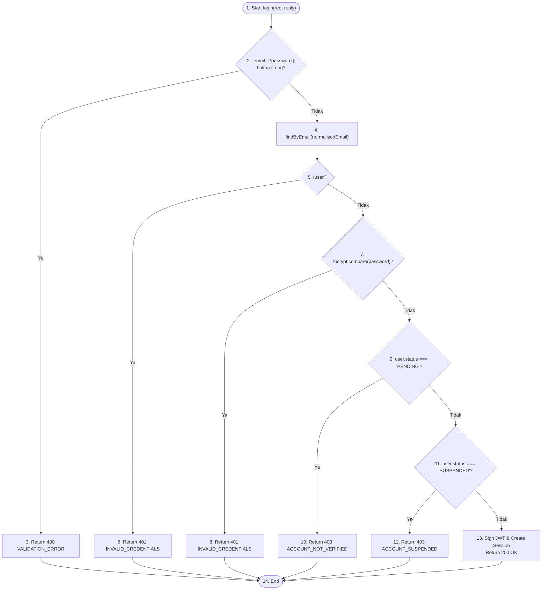
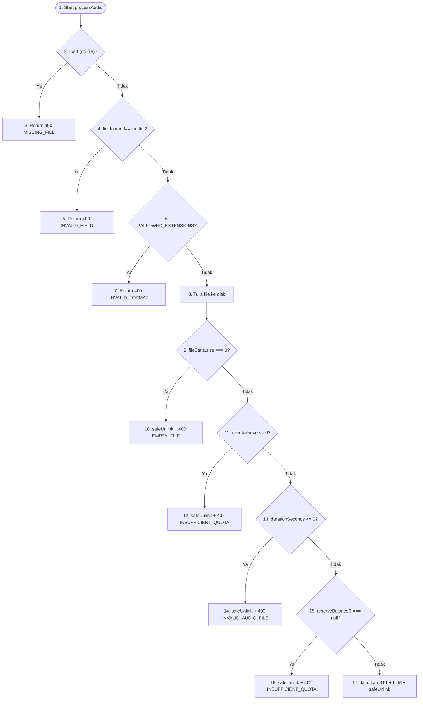
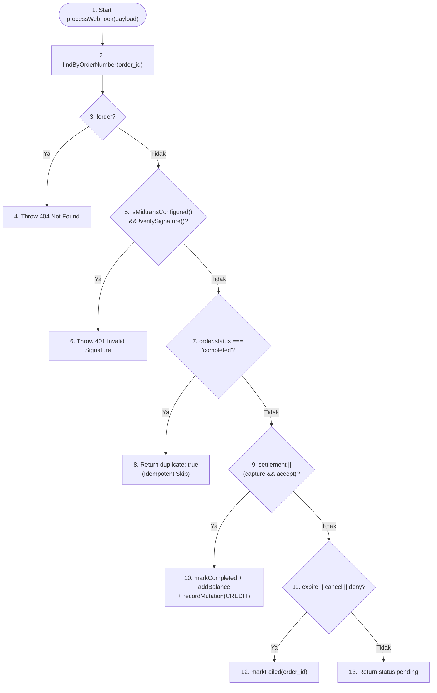
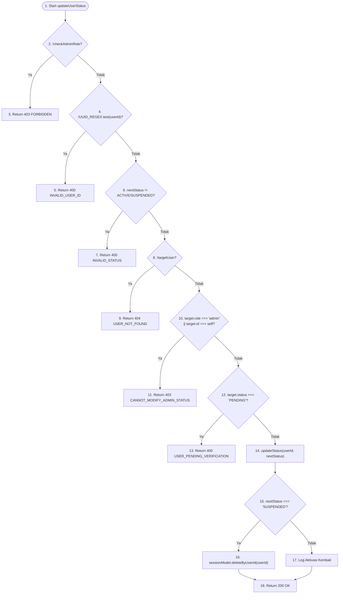

# 🔬 Dokumen Pengujian Perangkat Lunak — White-Box Testing

**Proyek**: SimpulKata (Platform Transkripsi Audio & Rangkuman AI)  
**Versi Aplikasi**: `v1.0.1-beta`  
**Mata Kuliah**: Implementasi dan Pengujian Perangkat Lunak (IPPL)  
**Pengembang / Penguji**: Kevin Jonathan Wijaya (NIM: 11241040)  
**Tanggal Pengujian**: 27 November 2026  
**Framework Uji Otomatis**: `Vitest v5.1.2` + `@vitest/coverage-v8` (`npm --prefix backend run test:coverage`)  
**Lampiran Output Verbatim**: [referensi/TESTING_WHITEBOX_OUTPUT.md](./TESTING_WHITEBOX_OUTPUT.md)

---

## 1. Metodologi Pengujian White-Box

Pengujian **White-Box** dilakukan dengan meninjau langsung struktur logika internal kode sumber (*control flow*, percabangan `if/else`, *guard clause*, perulangan, dan blok `try/catch`). Teknik yang diterapkan meliputi:

1. ***Control Flow Graph* (CFG)**: Memetakan alur eksekusi fungsi ke dalam node proses dan edge keputusan.
2. ***Cyclomatic Complexity* $V(G)$**: Menghitung kompleksitas logika untuk menentukan batas minimum kasus uji menggunakan rumus:
   $$V(G) = E - N + 2 \quad \text{atau} \quad V(G) = P + 1$$
   *(di mana $E$ = jumlah edge, $N$ = jumlah node, dan $P$ = jumlah predicate/titik percabangan).*
3. ***Basis Path Testing***: Menyusun *Independent Paths* agar setiap cabang keputusan (`true` / `false`) minimal tereksekusi satu kali (*Branch Coverage*).
4. ***Automated Unit Testing***: Mengeksekusi seluruh **58 kasus uji** secara otomatis melalui `backend/tests/*.test.ts`.

---

## 2. Analisis Modul 1: `authController` (`login`, `register`, `refreshSession`)

**Berkas Sumber**: [`backend/src/controllers/authController.ts`](file:///home/kevin007/proyek/ippl/simpulkata/backend/src/controllers/authController.ts)  
**Test Suite**: [`backend/tests/authController.test.ts`](file:///home/kevin007/proyek/ippl/simpulkata/backend/tests/authController.test.ts) (16 Test Cases)

### 2.1 Control Flow Graph (`login` — Baris 387–505)



- **Cyclomatic Complexity `login`**: $P = 5 \Rightarrow V(G) = 5 + 1 = 6$ jalur independen.

### 2.2 Tabel Kasus Uji White-Box (`authController`)

| ID | Fungsi Target | Kondisi Cabang / Jalur | Input / Kondisi Mock | Expected Result | Actual Result | Status |
|---|---|---|---|---|---|---|
| `WB-AUTH-01` | `login` | Path 1 (`N2 = true`) | `{ email: 123, password: '' }` | `400 VALIDATION_ERROR` | `400 VALIDATION_ERROR` | **Pass** |
| `WB-AUTH-02` | `login` | Path 2 (`N5 = true`) | `findByEmail -> null` | `401 INVALID_CREDENTIALS` | `401 INVALID_CREDENTIALS` | **Pass** |
| `WB-AUTH-03` | `login` | Path 3 (`N7 = true`) | `bcrypt.compare -> false` | `401 INVALID_CREDENTIALS` | `401 INVALID_CREDENTIALS` | **Pass** |
| `WB-AUTH-04` | `login` | Path 4 (`N9 = true`) | `user.status = 'PENDING'` | `403 ACCOUNT_NOT_VERIFIED` | `403 ACCOUNT_NOT_VERIFIED` | **Pass** |
| `WB-AUTH-05` | `login` | Path 5 (`N11 = true`) | `user.status = 'SUSPENDED'` | `403 ACCOUNT_SUSPENDED` | `403 ACCOUNT_SUSPENDED` | **Pass** |
| `WB-AUTH-06` | `login` | Path 6 (`N11 = false`) | `user.status = 'ACTIVE'` | `200 OK` + JWT & session | `200 OK` + token & session | **Pass** |
| `WB-AUTH-07` | `register` | Nama `< 2` karakter | `{ name: 'A' }` | `400 VALIDATION_ERROR` | `400 VALIDATION_ERROR` | **Pass** |
| `WB-AUTH-08` | `register` | Regex email gagal | `{ email: 'budi@invalid' }` | `400 VALIDATION_ERROR` | `400 VALIDATION_ERROR` | **Pass** |
| `WB-AUTH-09` | `register` | Password tanpa angka | `{ password: 'abcdefgh' }` | `400 VALIDATION_ERROR` | `400 VALIDATION_ERROR` | **Pass** |
| `WB-AUTH-10` | `register` | Email sudah `ACTIVE` | `existingUser.status = 'ACTIVE'` | `409 EMAIL_ALREADY_EXISTS` | `409 EMAIL_ALREADY_EXISTS` | **Pass** |
| `WB-AUTH-11` | `register` | Registrasi sukses | `existingUser = null` | `201 Created`, `PENDING`, OTP dikirim | `201 Created`, OTP dikirim | **Pass** |
| `WB-AUTH-12` | `refreshSession` | Token kosong | `body: {}` | `400 VALIDATION_ERROR` | `400 VALIDATION_ERROR` | **Pass** |
| `WB-AUTH-13` | `refreshSession` | Sesi tidak ditemukan | `findByRefreshToken -> null` | `401 INVALID_REFRESH_TOKEN` | `401 INVALID_REFRESH_TOKEN` | **Pass** |
| `WB-AUTH-14` | `refreshSession` | Sesi kedaluwarsa | `expires_at < now` | `401 SESSION_EXPIRED` + delete | `401 SESSION_EXPIRED` + delete | **Pass** |
| `WB-AUTH-15` | `refreshSession` | Guard `SUSPENDED` | `getStatusById -> 'SUSPENDED'` | `403 ACCOUNT_SUSPENDED` + revoke | `403 ACCOUNT_SUSPENDED` + revoke | **Pass** |
| `WB-AUTH-16` | `refreshSession` | Refresh Token Rotation | Sesi valid & `ACTIVE` | `200 OK` + `sessionModel.rotate` | `200 OK` + token baru | **Pass** |

---

## 3. Analisis Modul 2: `audioController.processAudio`

**Berkas Sumber**: [`backend/src/controllers/audioController.ts` (Baris 197–315)](file:///home/kevin007/proyek/ippl/simpulkata/backend/src/controllers/audioController.ts#L197-L315)  
**Test Suite**: [`backend/tests/audioController.test.ts`](file:///home/kevin007/proyek/ippl/simpulkata/backend/tests/audioController.test.ts) (7 Test Cases)

### 3.1 Control Flow Graph (CFG)



- **Cyclomatic Complexity**: $P = 7 \Rightarrow V(G) = 7 + 1 = 8$ jalur independen.

### 3.2 Tabel Kasus Uji White-Box (`audioController.processAudio`)

| ID | Jalur | Kondisi Cabang yang Diuji | Expected Return | Actual Return | Status |
|---|---|---|---|---|---|
| `WB-AUD-01` | Path 1 | `request.file() -> null` | `400 MISSING_FILE` | `400 MISSING_FILE` | **Pass** |
| `WB-AUD-02` | Path 2 | `part.fieldname = 'video'` | `400 INVALID_FIELD` | `400 INVALID_FIELD` | **Pass** |
| `WB-AUD-03` | Path 3 | `filename = 'catatan.txt'` | `400 INVALID_FORMAT` | `400 INVALID_FORMAT` | **Pass** |
| `WB-AUD-04` | Path 4 | `fileStats.size = 0` | `400 EMPTY_FILE` + file dihapus | `400 EMPTY_FILE` + `safeUnlink` | **Pass** |
| `WB-AUD-05` | Path 5 | `user.balance = 0` | `402 INSUFFICIENT_QUOTA` | `402 INSUFFICIENT_QUOTA` | **Pass** |
| `WB-AUD-06` | Path 6 | `getAudioDuration() -> 0` | `400 INVALID_AUDIO_FILE` + file dihapus | `400 INVALID_AUDIO_FILE` + `safeUnlink` | **Pass** |
| `WB-AUD-07` | Path 7 | `duration = 120`, `balance = 30`, `reserveBalance -> null` | `402 INSUFFICIENT_QUOTA`, AI tidak dipanggil | `402 INSUFFICIENT_QUOTA`, AI aman | **Pass** |

---

## 4. Analisis Modul 3: `uploadController.initUpload` (*Chunked Upload 200MB*)

**Berkas Sumber**: [`backend/src/controllers/uploadController.ts` (Baris 74–160)](file:///home/kevin007/proyek/ippl/simpulkata/backend/src/controllers/uploadController.ts#L74-L160)  
**Test Suite**: [`backend/tests/uploadController.test.ts`](file:///home/kevin007/proyek/ippl/simpulkata/backend/tests/uploadController.test.ts) (6 Test Cases)

| ID | Kondisi Cabang / BVA | Input Uji | Expected Return | Actual Return | Status |
|---|---|---|---|---|---|
| `WB-UPL-01` | `!userId` | `request.user` kosong | `401 UNAUTHORIZED` | `401 UNAUTHORIZED` | **Pass** |
| `WB-UPL-02` | `!fileName` | `fileName` tidak dikirim | `400 INVALID_FILENAME` | `400 INVALID_FILENAME` | **Pass** |
| `WB-UPL-03` | `!ALLOWED_EXTENSIONS` | `fileName: 'virus.exe'` | `400 INVALID_FORMAT` | `400 INVALID_FORMAT` | **Pass** |
| `WB-UPL-04` | BVA `fileSize > MAX_TOTAL_SIZE` | `fileSize: 201 MB` | `400 INVALID_FILE_SIZE` | `400 INVALID_FILE_SIZE` | **Pass** |
| `WB-UPL-05` | BVA `totalChunks > MAX_CHUNKS` | `totalChunks: 201` | `400 INVALID_TOTAL_CHUNKS` | `400 INVALID_TOTAL_CHUNKS` | **Pass** |
| `WB-UPL-06` | `user.balance <= 0` | `balance = 0` | `402 INSUFFICIENT_QUOTA` | `402 INSUFFICIENT_QUOTA` | **Pass** |

---

## 5. Analisis Modul 4: `userController` (`changePassword` & `getQuotaMutations`)

**Berkas Sumber**: [`backend/src/controllers/userController.ts` (Baris 360–515)](file:///home/kevin007/proyek/ippl/simpulkata/backend/src/controllers/userController.ts#L360-L515)  
**Test Suite**: [`backend/tests/userController.test.ts`](file:///home/kevin007/proyek/ippl/simpulkata/backend/tests/userController.test.ts) (7 Test Cases)

| ID | Fungsi & Cabang Logika | Input Uji | Expected Return | Actual Return | Status |
|---|---|---|---|---|---|
| `WB-USR-01` | BVA `newPassword.length < 8` | `newPassword: 'Ab1'` | `400 VALIDATION_ERROR` | `400 VALIDATION_ERROR` | **Pass** |
| `WB-USR-02` | Regex huruf & angka gagal | `newPassword: 'abcdefghij'` | `400 VALIDATION_ERROR` | `400 VALIDATION_ERROR` | **Pass** |
| `WB-USR-03` | `newPassword !== confirmPassword` | `'NewPass123'` vs `'NewPass999'` | `400 VALIDATION_ERROR` | `400 VALIDATION_ERROR` | **Pass** |
| `WB-USR-04` | `currentPassword === newPassword` | Password baru sama dengan lama | `400 SAME_PASSWORD` | `400 SAME_PASSWORD` | **Pass** |
| `WB-USR-05` | `bcrypt.compare -> false` | Password lama salah | `400 INVALID_PASSWORD` | `400 INVALID_PASSWORD` | **Pass** |
| `WB-USR-06` | Sukses ubah password + cabut sesi | Kredensial valid | `200 OK` + `deleteByUserId` | `200 OK` + semua sesi dicabut | **Pass** |
| `WB-USR-07` | `getQuotaMutations` filter tipe | `type: 'CREDIT', page: 1` | `200 OK` + query terfilter | `200 OK` | **Pass** |

---

## 6. Analisis Modul 5: `paymentService` (`verifySignature` & `processWebhook`)

**Berkas Sumber**: [`backend/src/services/paymentService.ts` (Baris 248–380)](file:///home/kevin007/proyek/ippl/simpulkata/backend/src/services/paymentService.ts#L248-L380)  
**Test Suite**: [`backend/tests/paymentService.test.ts`](file:///home/kevin007/proyek/ippl/simpulkata/backend/tests/paymentService.test.ts) (6 Test Cases)



- **Cyclomatic Complexity**: $P = 5 \Rightarrow V(G) = 5 + 1 = 6$ jalur independen.

| ID | Jalur / Kondisi | Input / Mock | Expected Result | Actual Result | Status |
|---|---|---|---|---|---|
| `WB-PAY-01` | `verifySignature` SHA-512 | Signature valid vs `tampered-sig` | `true` / `false` | `true` / `false` | **Pass** |
| `WB-PAY-02` | Path 1 (`P3 = true`) | `findByOrderNumber -> null` | Throw `statusCode: 404` | Error `404` dilempar | **Pass** |
| `WB-PAY-03` | Path 2 (`P5 = true`) | `signature_key: 'fake-signature'` | Throw `statusCode: 401` | Error `401` dilempar | **Pass** |
| `WB-PAY-04` | Path 3 (`P7 = true`) | `order.status = 'completed'` | `duplicate: true`, saldo tidak diubah | `duplicate: true`, saldo aman | **Pass** |
| `WB-PAY-05` | Path 4 (`P9 = true`) | `transaction_status: 'settlement'` | `markCompleted` + `addBalance` + `CREDIT` | Ketiganya dipanggil akurat | **Pass** |
| `WB-PAY-06` | Path 5 (`P11 = true`) | `transaction_status: 'expire'` | `markFailed('ORD-123', 'failed')` | `markFailed` dipanggil | **Pass** |

---

## 7. Analisis Modul 6: `aiService` (`cleanWhisperTranscript` & `removeRepetitiveLoops`)

**Berkas Sumber**: [`backend/src/services/aiService.ts` (Baris 353–419)](file:///home/kevin007/proyek/ippl/simpulkata/backend/src/services/aiService.ts#L353-L419)  
**Test Suite**: [`backend/tests/aiService.test.ts`](file:///home/kevin007/proyek/ippl/simpulkata/backend/tests/aiService.test.ts) (7 Test Cases)

| ID | Kondisi Cabang / Loop | Input Uji | Expected Output | Actual Output | Status |
|---|---|---|---|---|---|
| `WB-AI-01` | Guard `!text` (`true`) | `""` | `""` | `""` | **Pass** |
| `WB-AI-02` | `hallucinationPatterns` | Teks + *"Terima kasih telah menonton! Jangan lupa like..."* | Halusinasi terhapus | Bersih sesuai ekspektasi | **Pass** |
| `WB-AI-03` | Pengulangan kata $\ge 4\times$ | `"Jadi di di di di di dalam rapat kita sepakat."` | `"Jadi di dalam rapat kita sepakat."` | Sama persis | **Pass** |
| `WB-AI-04` | Pengulangan frasa $\ge 3\times$ | `"Sudah. Sudah. Sudah. Sudah. Baik kita lanjutkan."` | `"Sudah. Baik kita lanjutkan."` | Sama persis | **Pass** |
| `WB-AI-05` | Teks normal | `"Rapat evaluasi berjalan lancar dan kondusif."` | Teks tetap utuh | Sama persis | **Pass** |
| `WB-AI-06` | `removeRepetitiveLoops` pendek | Teks `< 100` char & teks 2 paragraf | Teks tidak terpotong | Sama persis | **Pass** |
| `WB-AI-07` | `removeRepetitiveLoops` loop | 4 paragraf dengan paragraf ke-3 duplikat ke-1 | Loop terputus sebelum paragraf ke-3 & 4 | Paragraf ke-4 terpotong | **Pass** |

---

## 8. Analisis Modul 7: `adminController` (`addUserQuota`, `updateUserStatus`, `getUserQuotaMutations`)

**Berkas Sumber**: [`backend/src/controllers/adminController.ts` (Baris 430–714)](file:///home/kevin007/proyek/ippl/simpulkata/backend/src/controllers/adminController.ts#L430-L714)  
**Test Suite**: [`backend/tests/adminController.test.ts`](file:///home/kevin007/proyek/ippl/simpulkata/backend/tests/adminController.test.ts) (9 Test Cases)



| ID | Fungsi & Kondisi Cabang | Input / Mock | Expected Result | Actual Result | Status |
|---|---|---|---|---|---|
| `WB-ADM-01` | `checkAdminRole` gagal | `user.role = 'user'` | `403 FORBIDDEN` | `403 FORBIDDEN` | **Pass** |
| `WB-ADM-02` | Validasi UUID gagal | `userId = 'bukan-uuid'` | `400 INVALID_USER_ID` | `400 INVALID_USER_ID` | **Pass** |
| `WB-ADM-03` | BVA menit kuota `< 1` | `minutes = 0` | `400 INVALID_QUOTA_AMOUNT` | `400 INVALID_QUOTA_AMOUNT` | **Pass** |
| `WB-ADM-04` | Target berstatus `PENDING` | `targetUser.status = 'PENDING'` | `400 USER_PENDING_VERIFICATION` | `400 USER_PENDING_VERIFICATION` | **Pass** |
| `WB-ADM-05` | Tambah kuota manual sukses | `minutes = 30`, `note = 'Bonus'` | `200 OK`, `balance = 3600` | `200 OK`, `balance = 3600` | **Pass** |
| `WB-ADM-06` | Proteksi sesama Admin | `targetUser.role = 'admin'` | `403 CANNOT_MODIFY_ADMIN_STATUS` | `403 CANNOT_MODIFY_ADMIN_STATUS` | **Pass** |
| `WB-ADM-07` | Suspend mencabut sesi aktif | `status = 'SUSPENDED'` | `200 OK`, `deleteByUserId` dipanggil 1x | `200 OK`, sesi tercabut | **Pass** |
| `WB-ADM-08` | Penyamaran privasi mutasi | Mutasi `TRANSCRIPTION`, `REFUND`, `TOPUP` | Nama berkas & `reference_id` transkrip disamarkan (`null`) | Tersamarkan dengan aman | **Pass** |
| `WB-ADM-09` | Target user tidak ditemukan | `findById -> null` | `404 USER_NOT_FOUND` | `404 USER_NOT_FOUND` | **Pass** |

---

## 9. Ringkasan Hasil Eksekusi & V8 Code Coverage (`Vitest`)

Hasil eksekusi perintah `npm --prefix backend run test:coverage` pada **27 November 2026**:

```text
 Test Files  7 passed (7)
      Tests  58 passed (58)
   Duration  4.97s
```

| Test Suite | Jumlah Test | Lulus | Gagal | Target Modul |
|---|---:|---:|---:|---|
| `tests/authController.test.ts` | 16 | 16 | 0 | `authController.ts` (`login`, `register`, `refreshSession`) |
| `tests/adminController.test.ts` | 9 | 9 | 0 | `adminController.ts` (`addUserQuota`, `updateUserStatus`, `getUserQuotaMutations`) |
| `tests/audioController.test.ts` | 7 | 7 | 0 | `audioController.ts` (`processAudio`) |
| `tests/userController.test.ts` | 7 | 7 | 0 | `userController.ts` (`changePassword`, `getQuotaMutations`) |
| `tests/aiService.test.ts` | 7 | 7 | 0 | `aiService.ts` (`cleanWhisperTranscript`, `removeRepetitiveLoops`) |
| `tests/uploadController.test.ts` | 6 | 6 | 0 | `uploadController.ts` (`initUpload`) |
| `tests/paymentService.test.ts` | 6 | 6 | 0 | `paymentService.ts` (`verifySignature`, `processWebhook`) |
| **Total** | **58** | **58** | **0** | **100% Lulus** |
